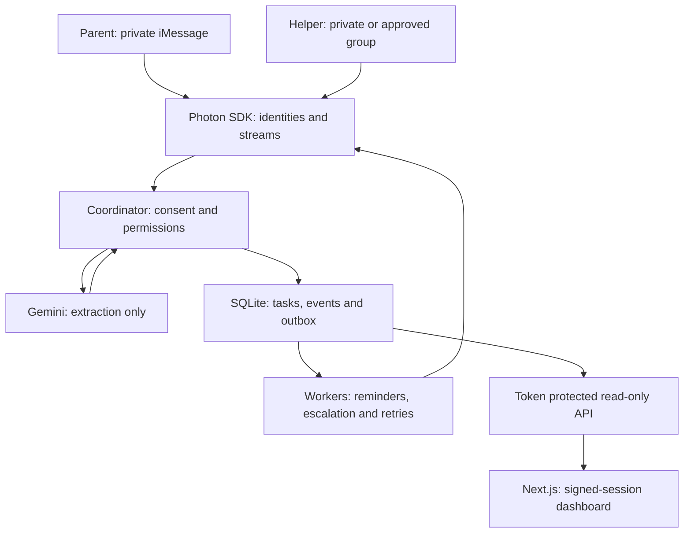

# Architecture

The public walkthrough is a separate, fictional client-side experience. It is never a fallback for missing private API data.

## Authority and consent

Photon supplies canonical sender IDs, inbound direction, conversation types and authenticated lazy attachment streams. The coordinator ignores other platforms, outbound messages, unknown senders, unsupported events and unconfigured groups. It downloads/analyses a parent's image only after private START consent. Helper JOIN is required before sharing. Parent approval is accepted only in the bound private conversation. An existing group must contain only the configured parent/helper, excluding the agent, at every handoff.

The coordinator serializes inbound handling in one process. It checks persisted event IDs before extraction and again inside an IMMEDIATE SQLite transaction. Task mutations, event receipt and outgoing messages commit together. One active letter avoids ambiguous bare SÍ approvals; explicit task IDs are validated and malformed IDs never select another task. Task claims use a conditional database update. State-transition rules prevent terminal-task resurrection.

The extractor uses an instruction boundary and JSON schema. Zod rejects extra fields, malformed types and excessive output. Invalid calendar dates, missing quotes, unknown currency and inconsistent quote/transcription pairs require review. Spanish purpose/action are explicit fields. Full OCR and dedicated contact/reference fields are not retained. Evidence quotes can still contain sensitive text from the letter. Quotes and supported facts remain model-generated and require human checking against the image.

## Durable outgoing queue

Sends are persisted in the same transaction as the task update and event. A worker claims a 60-second delivery lease, validates current consent and task status, sends, and acknowledges it. Errors retry with bounded exponential backoff. Stale notifications are consumed without sending after cancellation, completion or opt-out. Reminder acknowledgement timestamps are recorded only after successful dispatch. Escalation starts one hour after **actual handoff dispatch**, not document upload or approval. A zero demo interval schedules a reminder for UTC noon on the day before the indicated date (or the next day when no deadline is available), with a minimum one-minute delay for already overdue dates. Production needs local-time and deadline policy customization.

Delivery is **at least once**, not exactly once. Crashing after Photon accepts a send but before SQLite records acknowledgement can duplicate it. Photon `space.send` currently exposes no verified application idempotency option. An in-flight send may arrive after cancellation/opt-out. Slow sends lasting longer than the lease can also repeat. Run one agent process; incoming processing is not a distributed inbox.

## Dashboard boundary

The agent API is disabled unless a sufficiently long token is configured, binds to loopback and accepts authenticated GET only. It strips phone numbers, DM identifiers, owner identifiers and completion notes. Next keeps the token server-side, verifies an eight-hour signed session for every data request and fetches without caching. Same-origin session mutations, HttpOnly/Secure/SameSite cookies, a per-process login limiter and frame/referrer headers protect the prototype's shared-password boundary. API errors do not surface provider responses or secrets.

## Operational limits

- Single configured family, one helper, one active letter and one continuously running agent.
- SQLite on persistent disk; no encrypted database, retention purge, backups, or production member provisioning.
- No automatic HEIC conversion, voice, rich cards or reaction-based claims.
- Provider credentials/plan/line/membership/image-transfer behavior remain live-test gates.
- Shared dashboard password and local rate limiting are not multi-user production authentication.
